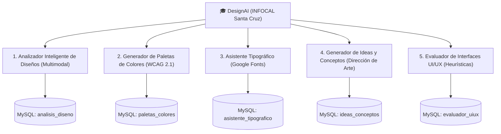

# DesignAI — INFOCAL Santa Cruz
## Plataforma Inteligente de Asistencia para el Aprendizaje de Diseño Gráfico mediante Inteligencia Artificial

[](https://nodejs.org/)
[](https://expressjs.com/)
[](https://www.mysql.com/)
[](https://tailwindcss.com/)
[](https://aistudio.google.com/)

---

### 1. Rol y Contexto Institucional
**DesignAI** es un ecosistema académico y profesional desarrollado para los estudiantes y docentes de la carrera de **Diseño Gráfico y Comunicación Visual** de **INFOCAL Santa Cruz**. Su propósito es complementar el proceso de enseñanza y aprendizaje mediante el análisis objetivo de piezas gráficas, el cálculo de accesibilidad cromática WCAG, la recomendación de armonías tipográficas, la dirección de arte conceptual y la evaluación heurística de interfaces UI/UX.

---

### 2. Stack Tecnológico Obligatorio
- **Backend:** Node.js con Express 4.x.
- **Base de Datos & ORM:** MySQL gestionada mediante Sequelize y driver nativo `mysql2`.
- **Frontend:** Tailwind CSS (diseño responsive mobile-first) y JavaScript Vanilla con Fetch API.
- **Inteligencia Artificial:** SDK oficial `@google/genai` con modelos multimodales (`gemini-2.5-flash` o superior) gobernados por esquemas estrictos de validación JSON Schema (`responseJsonSchema` con `Type`).
- **Almacenamiento de Archivos:** Multer para gestión temporal de imágenes y filtrado por tipos MIME (`image/jpeg`, `image/png`, `image/webp`).
- **Seguridad:** Cifrado unidireccional de contraseñas con `bcryptjs` (salt rounds: 10) y sesiones HTTP protegidas.

---

### 3. Identidad Institucional y Accesibilidad (INFOCAL Santa Cruz)
El diseño respeta estrictamente la identidad visual de la institución:
- **Logotipo Oficial:** Se incluye un contenedor estructurado con la etiqueta de accesibilidad obligatoria:
  ```html
  
  ```
- **Paleta Cromática Oficial:**
  - **Azul Institucional Primario:** `#002D62`
  - **Acento Tecnológico / IA:** `#2563EB` (Azul vibrante) y `#7C3AED` (Violeta)
  - **Fondo General:** `#F8FAFC` (Gris claro ultra limpio)
  - **Textos y Jerarquía:** `#1E293B` (Grafito pizarra)
- **Diseño Responsivo (Mobile-First):** Adaptable de forma fluida desde pantallas móviles de **320px** hasta monitores de **1920px**, transformando automáticamente barras laterales en menús superiores móviles con paneles deslizables.

---

### 4. Los 5 Módulos Principales del Sistema



1. **Analizador Inteligente de Diseños Gráficos (`/analizador`):**
   - El estudiante sube una imagen (afiche, red social, editorial, etc.) junto con sus objetivos de comunicación.
   - La IA evalúa **Composición** (regla de tercios, balance, espacio negativo), **Jerarquía Visual** (escala, recorrido de lectura) y **Contraste Cromático** (figura/fondo, legibilidad).
   - Genera puntuaciones de 1.0 a 10.0, aciertos detectados, recomendaciones de optimización y consejos pedagógicos.

2. **Generador Inteligente de Paletas de Colores (`/colores`):**
   - **Modalidad A (Por Concepto / Brief):** Diseña combinaciones cromáticas según el concepto, público y emoción deseada.
   - **Modalidad B (Extracción desde Imagen):** Permite subir una fotografía, ilustración, afiche o moodboard para que Gemini extraiga automáticamente la paleta representativa.
   - Aplica la regla áurea de diseño **60-30-10** (Dominante, Secundario, Acento, Texto, Fondo).
   - Realiza la **evaluación técnica de contraste WCAG 2.1** para lectura normal y títulos, informando conformidad **AA** y **AAA** con copiado de códigos HEX interactivo.

3. **Asistente Tipográfico (`/tipografia`):**
   - **Modalidad A (Por Proyecto y Estilo Teórico):** Recomienda el emparejamiento armónico por contraste entre familias tipográficas para títulos y cuerpo de texto según el proyecto.
   - **Modalidad B (Identificar y Emparejar desde Imagen):** Permite subir una imagen (afiche, portada de revista, logo, empaque) para que la IA identifique las fuentes presentes y recomiende pares homólogos y complementarios en Google Fonts.
   - Establece reglas de escala visual (tamaño en px, pesos, interlineado y longitud de línea de 50 a 75 caracteres).
   - Provee enlaces oficiales de **Google Fonts** con inyección y previsualización en vivo.

4. **Generador de Ideas y Conceptos Creativos (`/ideas`):**
   - Transforma un brief creativo en **3 rutas conceptuales diferenciadas** (vanguardista, orgánica/regional, minimalista tecnológica).
   - Extrae palabras clave estratégicas, metáforas visuales ilustrables, estilos gráficos y movimientos artísticos de referencia (Bauhaus, Estilo Suizo, etc.).

5. **Evaluador de Interfaces UI/UX (`/uiux`):**
   - Auditoría heurística de capturas de pantalla web o móviles (iOS / Android / Desktop).
   - Califica la usabilidad, distribución modular, escaneabilidad tipográfica y áreas de interacción táctil (mínimo 44x44 puntos).

---

### 5. Estructura de Directorios

```text
APP PARA DISEÑO GRAFICO/
├── config/
│   ├── database.js               # Conexión Sequelize y pool MySQL
│   └── multer.js                 # Almacenamiento seguro y filtro JPG/PNG/WEBP
├── controllers/                  # Controladores de lógica de negocio
│   ├── analizadorController.js   # Controlador Módulo 1 (Visión multimodal)
│   ├── authController.js         # Registro, Login (bcrypt) y Sesiones
│   ├── coloresController.js      # Controlador Módulo 2 (Paletas WCAG)
│   ├── dashboardController.js    # Métricas y estadísticas académicas
│   ├── ideasController.js        # Controlador Módulo 4 (Dirección de arte)
│   ├── tipografiaController.js   # Controlador Módulo 3 (Fuentes)
│   └── uiuxController.js         # Controlador Módulo 5 (Heurísticas UI/UX)
├── database/
│   ├── migrate.js                # Inicializador de base de datos automatizado
│   └── schema.sql                # DDL relacional con índices y claves foráneas
├── middleware/
│   └── authMiddleware.js         # Middlewares isAuthenticated y hasRole
├── models/                       # Modelos ORM Sequelize
│   ├── AnalisisDiseno.js
│   ├── AsistenteTipografico.js
│   ├── EvaluadorUIUX.js
│   ├── HistorialActividad.js
│   ├── IdeaConcepto.js
│   ├── index.js                  # Asociación de relaciones y cascadas
│   ├── PaletaColor.js
│   ├── Proyecto.js
│   └── Usuario.js
├── public/                       # Frontend estático y vistas
│   ├── css/                      # Estilos personalizados
│   ├── images/
│   │   └── logo-infocal.svg      # Logotipo oficial estructurado
│   ├── js/
│   │   ├── analizador.js         # Lógica cliente Módulo 1
│   │   ├── auth.js               # Lógica cliente de login y registro
│   │   ├── colores.js            # Lógica cliente Módulo 2
│   │   ├── common.js             # Sesión compartida y menú móvil
│   │   ├── dashboard.js          # Lógica cliente del Dashboard
│   │   ├── ideas.js              # Lógica cliente Módulo 4
│   │   ├── tipografia.js         # Lógica cliente Módulo 3
│   │   └── uiux.js               # Lógica cliente Módulo 5
│   ├── uploads/                  # Directorio temporal de Multer
│   ├── analizador.html
│   ├── colores.html
│   ├── dashboard.html
│   ├── ideas.html
│   ├── index.html
│   ├── login.html
│   ├── tipografia.html
│   └── uiux.html
├── routes/                       # Enrutadores Express
│   ├── analizadorRoutes.js
│   ├── authRoutes.js
│   ├── coloresRoutes.js
│   ├── dashboardRoutes.js
│   ├── ideasRoutes.js
│   ├── tipografiaRoutes.js
│   └── uiuxRoutes.js
├── services/
│   └── aiService.js              # Motor centralizado Gemini AI con JSON Schema
├── tests/
│   └── systemTest.js             # Suite de pruebas automatizadas (39 tests)
├── .env.example                  # Plantilla de variables de entorno
├── package.json                  # Dependencias y scripts de ejecución
└── server.js                     # Servidor Express principal
```

---

### 6. Guía de Instalación y Puesta en Marcha

#### Paso 1: Clonar o abrir la carpeta del proyecto
Abre una terminal en el directorio raíz de la aplicación:
```bash
cd "c:\Users\Usuario\Desktop\APP PARA DISEÑO GRAFICO"
```

#### Paso 2: Instalar las dependencias de Node.js
Ejecuta el gestor de paquetes para descargar e instalar todas las dependencias:
```bash
npm install
```

#### Paso 3: Configurar las Variables de Entorno (`.env`)
Crea o edita el archivo `.env` en la raíz del proyecto basándote en `.env.example`:
```env
# Servidor
PORT=3000
NODE_ENV=development

# Base de Datos MySQL
DB_HOST=localhost
DB_PORT=3306
DB_USER=root
DB_PASSWORD=
DB_NAME=designai_db

# Sesiones de Usuario
SESSION_SECRET=infocal_designai_2026_super_secret_session_key

# Google Gemini API
# Obtén tu clave en: https://aistudio.google.com/
GEMINI_API_KEY=tu_clave_gemini_api_aqui

# Modelo oficial Gemini
GEMINI_MODEL=gemini-2.5-flash

# Tamaño máximo de archivos (MB)
MAX_FILE_SIZE_MB=10
```

#### Paso 4: Inicializar la Base de Datos MySQL
Asegúrate de que tu servidor MySQL (XAMPP, Laragon, WampServer o Docker) se encuentre activo en el puerto 3306 y corre el migrador:
```bash
npm run db:migrate
```
*Este comando creará automáticamente la base de datos `designai_db`, sus 8 tablas relacionales con claves foráneas en cascada, índices y los usuarios iniciales.*

#### Paso 5: Ejecutar la Suite de Pruebas
Verifica que todos los componentes, archivos, modelos y el servicio de IA respondan al 100%:
```bash
npm test
```

#### Paso 6: Iniciar el Servidor Web
- **Para producción:**
  ```bash
  npm start
  ```
- **Para desarrollo (con autorecarga Nodemon):**
  ```bash
  npm run dev
  ```

Ingresa en tu navegador web a:
👉 **[http://localhost:3000](http://localhost:3000)** (o `/login`)

---

### 7. Credenciales de Acceso Rápido Demostrativo

El sistema incluye cuentas preconfiguradas con contraseñas cifradas en `bcrypt` para facilitar las pruebas académicas:

| Rol | Correo Institucional | Contraseña | Perfil y Alcance |
| :--- | :--- | :--- | :--- |
| **Estudiante** | `estudiante@infocal.edu.bo` | `Infocal2026!` | Uso de los 5 módulos de IA y registro en su portafolio personal. |
| **Administrador / Docente** | `admin@infocal.edu.bo` | `Infocal2026!` | Acceso completo y vista consolidada de métricas globales de uso. |

*Nota: La pantalla de login incluye botones de "Acceso Rápido" para cargar estas credenciales con un solo clic.*

---

### 8. Manejo de Errores y Tolerancia a Fallos de IA

Para asegurar una experiencia académica ininterrumpida:
- **Respaldo Pedagógico Automático:** Si `GEMINI_API_KEY` no se encuentra configurada, o la cuota de la API se agota temporalmente (HTTP 429), el servicio `services/aiService.js` conmuta automáticamente a un motor pedagógico local precalibrado, permitiendo que la interfaz siga funcionando sin pantallas blancas ni caídas del servidor.
- **Validación de Carga de Archivos:** Las imágenes que excedan los 10MB o que no correspondan a formatos gráficos válidos (JPG, PNG, WEBP) son interceptadas de inmediato devolviendo un mensaje en español claro para el estudiante.
- **Endpoint de Monitoreo (`/api/health`):** Permite verificar en tiempo real la conectividad con MySQL y el estado de la API de Gemini.

---

### 9. Licencia y Créditos
- **Institución:** Instituto de Formación y Capacitación Laboral (**INFOCAL Santa Cruz**).
- **Carrera:** Diseño Gráfico y Comunicación Visual.
- **Año:** 2026.
- Desarrollado como plataforma integral de asistencia y aprendizaje de diseño asistido por Inteligencia Artificial.
